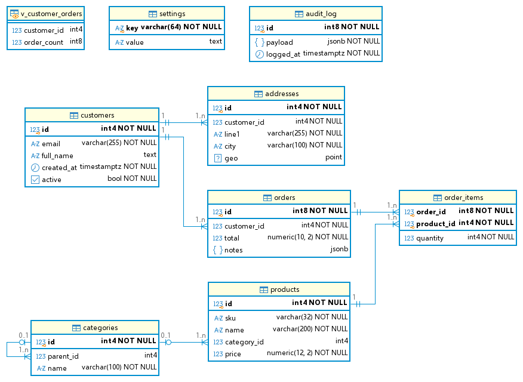
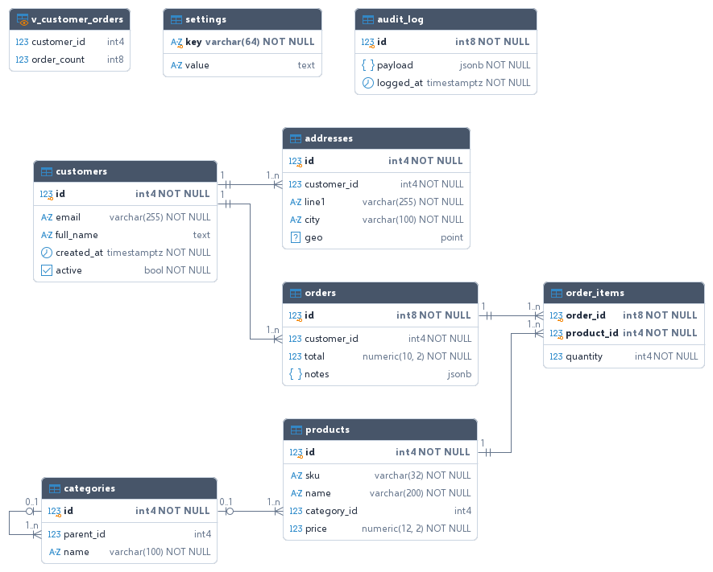
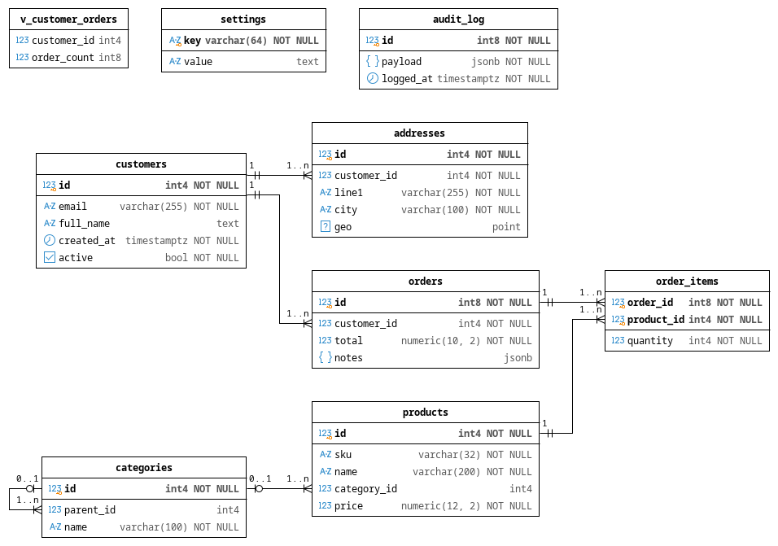
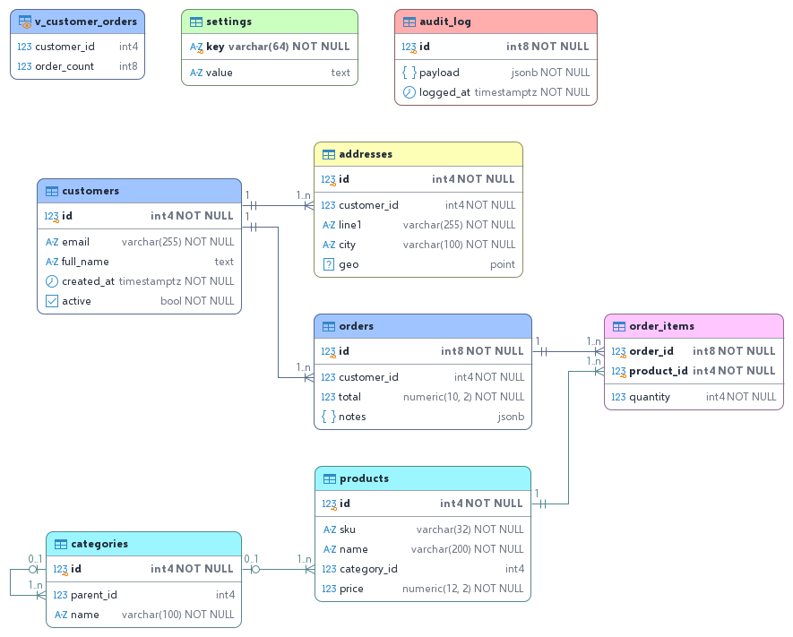
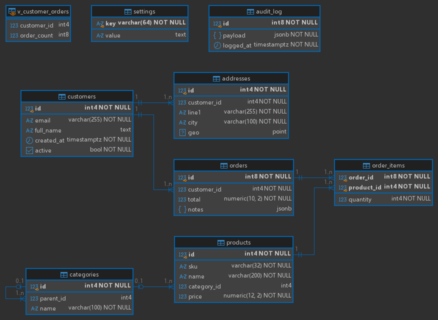
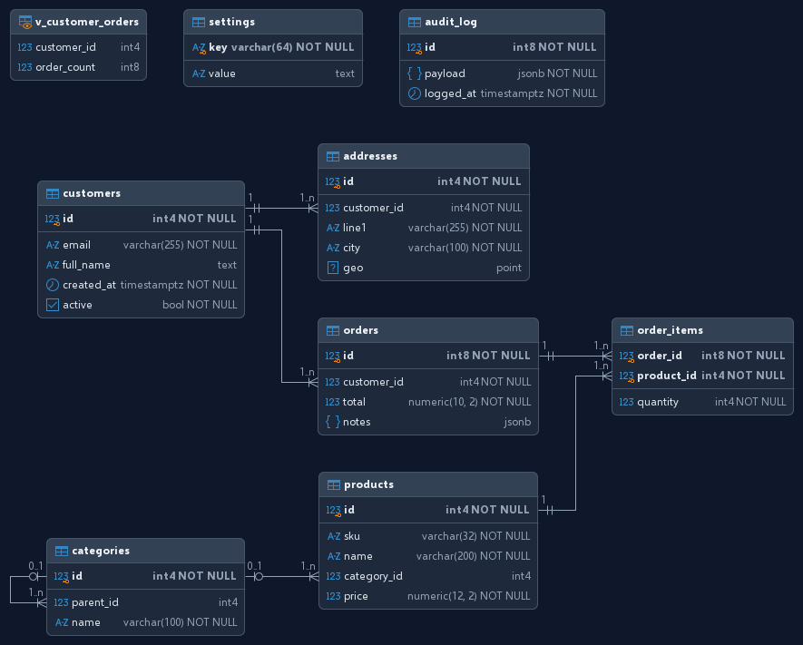
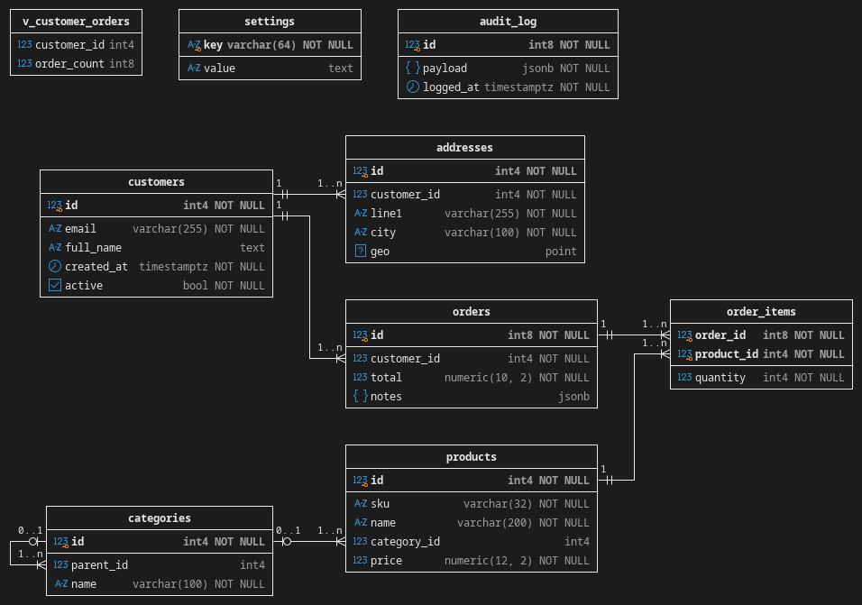
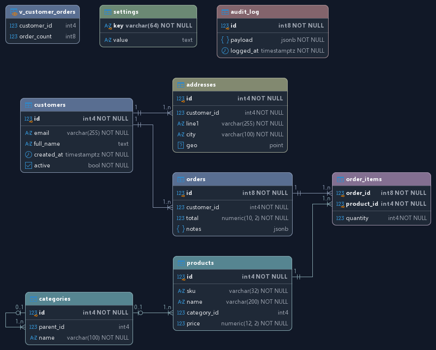

# dbeaver-erd

A headless command-line tool that connects to PostgreSQL and renders the schema as an
entity-relationship diagram that looks like the PNG you get from DBeaver's ERD editor
("Save as image"), so a CI or deploy job can produce the diagram without a GUI.

It re-implements DBeaver's ERD drawing rules (entity box layout, colours, icons, IDEF1X and
crow's-foot notation) in plain Java2D and lays the tables out with the Eclipse Layout Kernel
(ELK), which attaches every relation line to its foreign-key column and routes it with right angles.

```
java -jar dbeaver-erd.jar --url jdbc:postgresql://db.example.com:5432/app \
    --user app --schema public --out schema.png --svg schema.svg
```

The password is read from `PGPASSWORD` by default (`--password-env NAME` for another variable,
`--password` to pass it directly).

## Requirements

* Java 21 or newer to run the jar (no display or native libraries needed).
* PostgreSQL 10 or newer.
* The bundled font covers Latin only. Names and comments in other scripts (Cyrillic, Greek, CJK, ...)
  are drawn with the system's sans-serif font, so a CI image needs one that covers those scripts
  installed (for example `fonts-dejavu` or `fonts-noto` on Debian/Ubuntu, `dejavu-sans-fonts` on Fedora).

## Build

```
./gradlew build          # unit tests + build/libs/dbeaver-erd.jar
./gradlew integrationTest   # end-to-end against PostgreSQL in Docker (Testcontainers)
```

The build uses a Java 21 toolchain; if no JDK is installed, Gradle downloads one automatically.

## Options

| Option | Default | Meaning |
|---|---|---|
| `--url` | required | JDBC URL, e.g. `jdbc:postgresql://host:5432/db` |
| `-U`, `--user` | `PGUSER` / OS user | database user |
| `--password`, `--password-env VAR` | `PGPASSWORD` | password, or the environment variable holding it |
| `-s`, `--schema` | `public` | schema to diagram (DBeaver's "ER Diagram" tab on a schema) |
| `-t`, `--table` | | diagram one table plus the tables it references / that reference it (DBeaver's table ERD tab; the root table gets the orange header) |
| `--include`, `--exclude GLOB,...` | | table-name filters |
| `--no-views`, `--partitions` | views on, partitions off | same as DBeaver's preferences |
| `-o`, `--out FILE.png` | | PNG output |
| `--svg FILE.svg` | | SVG output (`--svg-embed-font` makes it self-contained) |
| `--scale N` | 1 | integer upscale of the PNG for HiDPI |
| `--notation idef1x\|crowsfoot` | `idef1x` | connection notation |
| `--attributes all\|keys\|primary\|none` | `all` | which columns to show |
| `--show types,nullability,comments,fqn,alpha` | | DBeaver's view styles (icons are on; `--hide icons` turns them off) |
| `--look dbeaver\|clean\|paper\|pastel` | `dbeaver` | visual style, see [Looks](#looks) |
| `--theme light\|dark` | `light` | light or dark variant of the look |
| `--color "key=#rrggbb;key=r,g,b"` | | colour overrides (see `--help` for the keys) |
| `--font FAMILY`, `--font-size PT` | bundled Selawik, 9 pt | font; Selawik has Segoe UI's metrics, DBeaver's default UI font |

Exit codes: 0 ok, 1 usage error, 2 database/render error, 3 no tables found.

## Looks

`--look` picks the visual style; `--theme dark` gives each one a dark variant and `--color`
still overrides single colours (`border`, `separator`, `type-foreground`, `header-foreground`
are the extra keys the non-DBeaver looks use).

| | |
|---|---|
| `dbeaver` (default): DBeaver's ERD editor, yellow headers, blue frames | `clean`: rounded cards, slate header bar, thin grey frame |
|  |  |
| `paper`: black and white, monospaced, prints well | `pastel`: a pastel header per table (by name), lines in the colour of the table they point to |
|  |  |

Dark variants of the same looks (`--theme dark`):

| | |
|---|---|
|  |  |
|  |  |

## How faithful is it?

* **Entities**: same box model as DBeaver's `EntityFigure` (title with table icon, bold primary-key
  section with the key overlay, attribute section, 2 px blue frame and separators), same colours,
  same icons.
* **Relations**: IDEF1X by default (dot at the FK end, hollow diamond at the parent end for nullable
  FKs, dotted line for non-identifying relations) or crow's foot with `1`, `1..n`, `0..1` labels.
* **Layout and routing**: the Eclipse Layout Kernel's layered algorithm, not DBeaver's arrangement.
  Parents are placed left of the tables that reference them; every line leaves the child through its
  FK column's row on the left edge and arrives at the parent's right edge next to the referenced key
  (several arrivals are spread 12 px / 24 px apart and ordered to avoid crossings); lines are routed with
  right angles, kept apart from each other and from tables. Self-references loop beside the table.
* **Types**: shown like DBeaver, i.e. PostgreSQL's internal names: `int4`, `varchar(255)`,
  `numeric(10, 2)`, `timestamptz`, `_text` for arrays, `schema.type` for user-defined types.

Differences you may notice: tables are arranged by ELK rather than DBeaver's "Arrange all", and the
lines are orthogonal instead of DBeaver's diagonal shortest paths; text is rendered by Java2D instead
of GDI/Cairo, so label widths can be a pixel off; and DBeaver takes a few colours from the OS theme
(here the Windows defaults are used, override with `--color`).

## CI example (GitHub Actions)

```yaml
- uses: actions/setup-java@v4
  with: { distribution: temurin, java-version: '21' }
- run: java -jar dbeaver-erd.jar --url "$DATABASE_JDBC_URL" --user "$DB_USER" --schema public --out docs/erd.png --svg docs/erd.svg
  env:
    PGPASSWORD: ${{ secrets.DB_PASSWORD }}
```

## Licenses

The tool is built on the Eclipse Layout Kernel (EPL-2.0), DBeaver's icons (Apache-2.0) and
the Selawik font (SIL OFL 1.1); see `THIRD_PARTY_NOTICES.md`.
